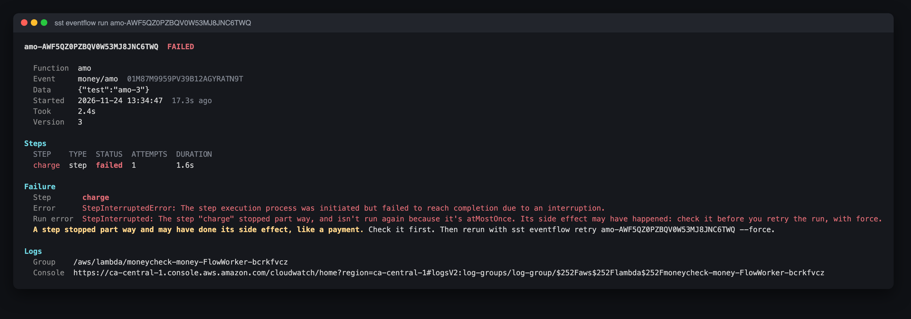
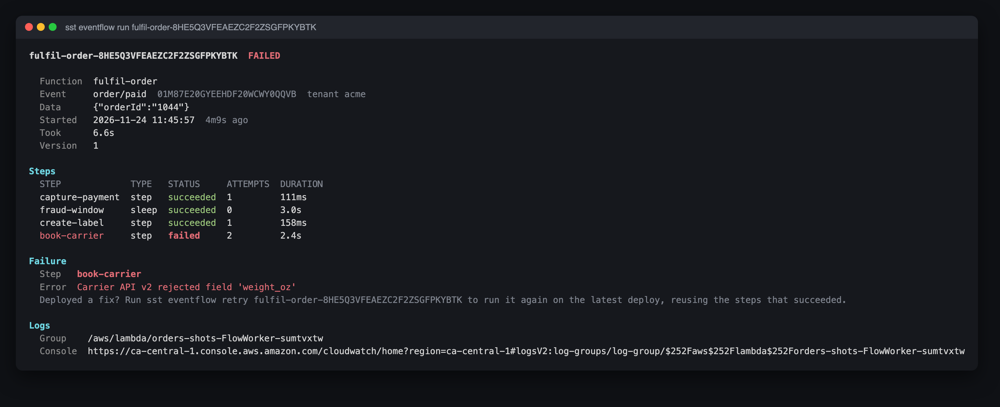
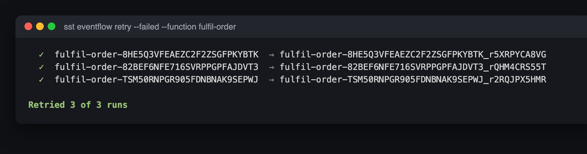
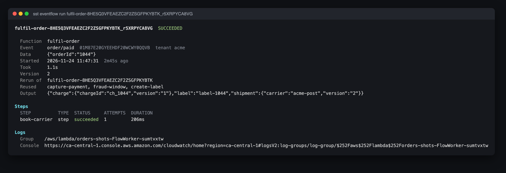

import { Tabs, TabItem } from '@astrojs/starlight/components';

[`EventFlow`](/docs/component/aws/eventflow) runs event-driven functions on [AWS Lambda durable functions](https://docs.aws.amazon.com/lambda/latest/dg/durable-functions.html), in your account. You write the functions with an API shaped like [Inngest's](https://www.inngest.com/docs/reference/typescript): send events, trigger functions with them, and write the functions as steps that retry, sleep, wait for other events, and invoke each other.

It's built on the [`Workflow`](/docs/component/aws/workflow) component, which stays as it is. Use `Workflow` when you start executions yourself. Use `EventFlow` when events should start them, and you want flow control per tenant, waits for events, and runs you can look up by ID.

:::tip
Moving from Inngest? Read [Migrate from Inngest](/docs/migrate-from-inngest) for what maps, what's different, and how to cut over.
:::

---

## How it works

You create an EventFlow once. It makes a fixed set of resources, and every function runs on them.

```txt
 send()                                                  ┌──────────────┐
 ─────▶ ┌───────────┐  batch  ┌────────┐  start run     │    Worker    │
        │   Queue   │ ──────▶ │ Router │ ─────────────▶ │  (durable)   │
        │ (SQS fair)│         └────────┘  resume wait   │ all functions│
        └───────────┘     ▲       │                     └──────────────┘
              ▲           │       │ dedup, leases, waits       │
   step.sendEvent()       │       ▼                            │
              └───────────┼─── ┌───────┐ ◀─────────────────────┘
                          │    │ Table │
          tick, each minute    └───────┘
          ┌──────────┐
          │ Schedule │
          └──────────┘
```

- **Queue.** A standard SQS queue, with a dead-letter queue. `send()` puts each event on it, with its tenant as the `MessageGroupId`, so SQS [fair queues](https://docs.aws.amazon.com/AWSSimpleQueueService/latest/SQSDeveloperGuide/sqs-fair-queues.html) keep one tenant's backlog from holding up the others.
- **Router.** A Lambda function that reads the queue. For each event it skips duplicates, resumes the waits it matches, and starts a run of each function it triggers, after the function's rate limit, idempotency key and throttle allow it. It also serves the [admin API](#look-at-it-and-fix-it).
- **Worker.** One durable Lambda function that runs every function of the EventFlow. A run is one durable execution, and its name is the run ID.
- **Table.** A DynamoDB table for the engine's state: event IDs, concurrency leases and the steps waiting for them, throttle buckets, and waits. Every item expires.
- **Schedule.** An EventBridge schedule that ticks each minute, to start the functions with cron triggers.

The router and the worker run the same handler, the one `serve()` returns, and tell their work apart by what invokes them. So adding a function, or changing one, is a code change. Nothing is added to the infrastructure.

Every run starts through the router, including invoked runs, held runs, retries and replays. The router signs what it starts with a key only it and the worker have, and the worker runs nothing that isn't signed. See [security](#security).

### More than one

To run some functions apart from the others, create another EventFlow. Each has its own queue, router, worker, table and schedule. Do it when functions need:

- a different memory size, timeout, VPC or runtime;
- different permissions, so a function that handles payments can't read what another one can;
- to scale, fail or be deployed apart from the rest.

```ts title="sst.config.ts"
const flow = new sst.aws.EventFlow("Flow", { handler: "src/flow.handler" });

const media = new sst.aws.EventFlow("Media", {
  handler: "src/media.handler",
  memory: "4 GB",
  timeout: { invocation: "15 minutes" },
  schedule: false,
});
```

A function linked to more than one passes the one it uses: `new EventFlow({ id: "media", resource: Resource.Media })`. An event sent to one EventFlow doesn't reach the other, and `step.invoke()` only invokes functions of the same EventFlow.

---

## Get started

The [AWS EventFlow example](/docs/examples/#aws-eventflow) has a complete app. These are the parts.

<Tabs>
  <TabItem label="sst.config.ts">
```ts
const flow = new sst.aws.EventFlow("Flow", {
  handler: "src/flow.handler",
  link: [bucket],
});

new sst.aws.Function("Api", {
  handler: "src/api.handler",
  url: true,
  link: [flow],
});
```
  </TabItem>
  <TabItem label="src/client.ts">
```ts
import { z } from "zod";
import { EventFlow, eventType } from "sst/aws/eventflow";

export const flow = new EventFlow({ id: "shop" });

export const orderPlaced = eventType("order/placed", {
  schema: z.object({ orderId: z.string(), amount: z.number() }),
});
```
  </TabItem>
  <TabItem label="src/flow.ts">
```ts
import { serve } from "sst/aws/eventflow";
import { flow, orderPlaced } from "./client";

const processOrder = flow.createFunction(
  { id: "process-order", triggers: { event: orderPlaced } },
  async ({ event, step }) => {
    const charge = await step.run("charge", () => charge(event.data));
    await step.sleep("wait", "1h");
    await step.run("follow-up", () => email(charge));
  },
);

export const handler = serve({ client: flow, functions: [processOrder] });
```
  </TabItem>
  <TabItem label="src/api.ts">
```ts
import { flow, orderPlaced } from "./client";

await flow.send(orderPlaced.create({ orderId, amount: 25 }, { id: `order-${orderId}` }));
```
  </TabItem>
</Tabs>

Everything linked to the EventFlow, like `bucket`, is linked to its worker, so every function can use it. A function the EventFlow is linked to can **send events, and nothing more**. To look at runs and change them, link [`flow.admin`](#look-at-it-and-fix-it) too, or use the `sst eventflow` CLI.

---

## Events

An event has a `name`, `data`, and optionally an `id`, a `ts` and a `tenant`.

```ts
await flow.send({
  name: "contacts/import.requested",
  id: `import-${importId}`,
  data: { file, tenantId },
  tenant: tenantId,
});
```

- **Fan-out.** Every function with a trigger for the event's name starts a run, and every wait it matches resumes. A trigger can have an `if`, like `'event.data.plan == "pro"'`.
- **IDs and duplicates.** An event without an `id` gets a [ULID](https://github.com/ulid/spec). An event whose `id` was sent by the same tenant in the last **24 hours** starts no runs and resumes no waits. So when `send()` fails, send again with the same IDs. The same message delivered twice by SQS is routed again, and starts nothing new, and so is a message moved back from the dead-letter queue: see [delivery](#delivery-guarantees). An ID is 1 to 128 printable characters.
- **Tenant.** `tenant` is SST's addition to the envelope. It's the message's `MessageGroupId` for fair queues, and the router refuses an event whose tenant isn't its group. Event IDs, idempotency keys, run IDs, waits, and limits without a key are all kept per tenant. Events sent from a run with `step.sendEvent()` keep the run's tenant. A tenant is 1 to 128 letters, digits and punctuation, as SQS allows. Take it from something you trust, like the signed-in user, not the request body: see [security](#security).
- **Size.** An event is at most **256 KB** of JSON. Put large data in a bucket, and send its key.
- **Types.** `eventType()` declares an event with a [Standard Schema](https://standardschema.dev), like Zod. A trigger with it types `event.data`, and `create()` checks the data when it's sent. `staticSchema<T>()` declares the type only.
- `send()` returns `{ ids }`. Up to 10 events go in one SQS request.

The names `inngest/scheduled.timer`, `inngest/function.invoked` and `inngest/function.failed` are used for cron runs, invoked runs and `onFailure`, as with Inngest.

---

## Functions

```ts
flow.createFunction(
  {
    id: "import-contacts",            // stable: the run IDs come from it
    triggers: [{ event: "contacts/import.requested" }, { cron: "TZ=Europe/Paris 0 3 * * *" }],
    retries: 4,                       // per step, 0 to 20
    concurrency: [{ limit: 5, key: "event.data.tenantId" }, { limit: 50 }],
    throttle: { limit: 100, period: "1m", key: "event.data.tenantId" },
    onFailure: async ({ error, event, step }) => { /* ... */ },
  },
  async ({ event, step, runId, logger }) => { /* ... */ },
);
```

- **Triggers.** Up to 10. An event trigger, with an optional `if`. A cron trigger, with 5 fields, in UTC or with a `TZ=` prefix. A function without triggers can only be invoked.
- **Cron.** The schedule ticks once a minute, and each cron trigger is checked against that minute. The run ID comes from the function and the minute, so a tick that's delivered twice starts one run. A tick that's lost isn't caught up.
- **Registration.** A function runs once it's in the list passed to `serve()`, and the EventFlow is deployed. `serve()` throws for two functions with the same ID.
- **Unsupported options throw.** `createFunction()` throws for an option EventFlow doesn't support, like `debounce`, and for an expression it can't evaluate. It doesn't ignore them. See [what's not supported](#not-supported).

A function's context has `event`, `events` (`[event]`), `step`, `group`, `runId` and `logger`. Reading `attempt` throws, since steps retry on their own and the handler isn't re-run for each attempt.

### Expressions

Keys, trigger `if`s and wait `if`s are a small part of [CEL](https://cel.dev): paths like `event.data.customerId`, string, number, `true`, `false` and `null` literals, the comparisons `==`, `!=`, `<`, `<=`, `>` and `>=`, and `&&`. Anything else, like `||`, `!`, `in` or a function call, throws when the function is created. A key can also be a function: `key: (event) => event.data.customerId`.

---

## Steps

```ts
const user = await step.run("load-user", () => db.users.get(event.data.userId));
```

A step's result is saved when it succeeds. When the run resumes, after a sleep, a wait or a crash, the handler runs again from the top, and each step that already succeeded returns its saved result without running. So:

- Put side effects, like API calls, writes, `Date.now()` and random IDs, inside steps.
- Keep the code between steps deterministic. The same inputs must call the same steps in the same order.
- A step's result is saved as JSON, so a `Date` comes back as a string.

### Retries

A step that throws is retried, up to the function's `retries`, which is **4** by default. So a step is tried at most 5 times. The backoff doubles from 2 seconds, with up to 50% jitter, to at most 10 minutes: about 1–2 s, 2–4 s, 4–8 s, 8–16 s.

- Throw `NonRetriableError` to fail the step now.
- Throw `RetryAfterError("…", "30s")` to choose when. It takes a duration, a `Date`, or a time string.
- A step that runs out of retries throws, with the error's message. Catch it to handle the failure, or let it fail the run. `onFailure` runs when the run fails.

An error thrown outside a step fails the run. It isn't retried, unlike Inngest, where the function is.

A step is **at least once**. If the worker crashes after the step's code ran, but before its result was saved, it runs again. Make side effects idempotent with `idempotencyKey`, or run the step `atMostOnce`: see [moving money](#moving-money).

### IDs

A step's ID is its name in the run's history. Used more than once, as in a loop, it gets the suffixes `:1`, `:2`, …, as with Inngest. Changing a step's ID, or the order of steps, breaks runs that are in flight on the old code only if they're replayed on the new code: see [deploying](#deploying).

### Sleep

```ts
await step.sleep("wait-a-day", "1d");
await step.sleepUntil("wait-for-launch", "2027-01-01T09:00:00Z");
```

A duration is a number of milliseconds or a string like `"30s"`, `"5m"`, `"2h"`, `"1d"` or `"1w"`. It's rounded up to whole seconds. A sleeping run costs nothing, and can sleep until its [execution timeout](/docs/component/aws/eventflow#timeout).

### Parallel steps

Steps started together run together:

```ts
const [user, plan] = await Promise.all([
  step.run("user", () => getUser(id)),
  step.run("plan", () => getPlan(id)),
]);
```

---

## Moving money

Payments, transfers and refunds have to happen once. A durable step is **at least once**: if the worker stops after the step's code ran, but before its result was saved, the step runs again. EventFlow gives you two ways to make that safe.

### Pass an idempotency key

Every function gets `idempotencyKey(stepId)`. Pass it to the payment provider, as most take one, like Stripe's `idempotencyKey`. It's the same in every attempt of the step, and in every [retry and replay](#retry-after-a-fix) of the run, and different for every other step and run. So a step that runs again makes the same request, and the provider does it once.

```ts
flow.createFunction(
  { id: "charge-order", triggers: { event: "order/placed" } },
  async ({ event, step, idempotencyKey }) => {
    const charge = await step.run("charge", () =>
      stripe.paymentIntents.create(
        { amount: event.data.amount, currency: "usd", customer: event.data.customer, confirm: true },
        { idempotencyKey: idempotencyKey("charge") },
      ),
    );
    await step.run("record", () => ledger.insert({ orderId: event.data.orderId, chargeId: charge.id }));
  },
);
```

Write to your own database the same way: an insert with the key as its primary key, or a conditional write, so a second try is a no-op.

### Or run the step at most once

For a call with no idempotency key, like some bank APIs, mark the step `atMostOnce`:

```ts
await step.run({ id: "wire", atMostOnce: true }, () => bank.sendWire(details));
```

AWS saves that the step started before its code runs. If the worker stops part way, the step isn't run again: the run fails with `StepInterrupted`, since the wire may or may not have been sent. It isn't retried when it throws, either. `sst eventflow run` says to check it, and a retry of the run is refused until you pass `--force`, after you've reconciled with the bank.

### What was tested

On AWS, with a step that charges and then crashes the Lambda before its result is saved:

| Step | Provider calls | Charges | Run |
|---|---|---|---|
| With `idempotencyKey` | 2 | **1** | Succeeded: the step ran again, and the provider kept the first charge |
| With `idempotencyKey`, and a concurrency limit | 2 | **1** | Succeeded |
| `atMostOnce` | 1 | **1** | Failed with `StepInterrupted`, to reconcile |
| `atMostOnce`, and a concurrency limit | 1 | **1** | Failed with `StepInterrupted` |
| `atMostOnce`, then `retry --force` | 2 | **1** | Succeeded: the key is the same in the retry |



### Rules for money

- Every side effect goes in a step, with `idempotencyKey`, or `atMostOnce`. Never outside a step: that code runs again on every replay of the run.
- Give events from your system an `id`, like the order's ID, so sending one twice starts one run.
- Use `idempotency: "event.data.orderId"` on the function as well, to start one run per order in 24 hours, whatever the event IDs.
- `cancelOn` and `flow.runs.cancel()` stop a run where it is. The steps that ran aren't undone. Refund in `onFailure`, or in a step after a `waitForEvent`, not by cancelling.
- A replay runs every step again, with the same idempotency keys. A provider that keeps keys for a limited time, like 24 hours, may charge again after that: retry, which reuses the saved results, rather than replay.

---

## Waiting for events

```ts
const approval = await step.waitForEvent("wait-for-approval", {
  event: "invoice/approved",
  timeout: "3d",
  match: "data.invoiceId",
});
if (!approval) return "expired";
```

It returns the event, or `null` when none comes before the timeout. Its rules:

- **Correlation.** `match: "data.invoiceId"` matches an event with the same value there as the run's event. Or use `if`, where `event` is the run's event and `async` is the event that comes: `'async.data.invoiceId == event.data.invoiceId && async.data.amount > 100'`. The first `async.… == event.…` is looked up directly. Without one, every event of that name for the tenant is checked.
- **Only after it starts.** It only matches events received after the wait has registered. An event sent before isn't matched, as with Inngest.
- **The race.** An event that arrives while the wait registers is still matched. The wait and the router each write, then read: the wait registers, then reads the events since it started, and the router stores the event, then reads the waits. So for an event received after the wait started, at least one of them sees the other. This is checked in the tests, with an event delivered between the wait's two writes.
- **Tenants.** It only matches events with the run's tenant.
- **Duplicates.** An event delivered twice resumes a wait once. Many waits can match one event, and they all resume.
- **Timeout.** Up to the run's execution timeout. Events are kept for a wait that's registering for 1 hour, and waits are kept until they time out.

### Invoke

```ts
const receipt = await step.invoke("send-receipt", {
  function: sendReceipt,
  data: { orderId },
  timeout: "10m",
});
```

It starts a run of another function of the same EventFlow, waits for it, and returns what it returns. If that run fails, or doesn't finish within the timeout, it throws an `InvokeError`. The invoked run keeps the tenant, and its own flow control applies. A timeout doesn't stop it.

### Send events

```ts
await step.sendEvent("notify", { name: "invoice/sent", data: { invoiceId } });
```

### Cancel on an event

```ts
flow.createFunction(
  {
    id: "reminder",
    triggers: { event: "reminder/scheduled" },
    cancelOn: [{ event: "reminder/cancelled", match: "data.reminderId" }],
  },
  async ({ event, step }) => {
    await step.sleepUntil("wait-for-time", event.data.remindAt);
    await step.run("send", () => send(event.data));
  },
);
```

When an event in `cancelOn` matches, the run is stopped, even while it sleeps or waits. Its status is `STOPPED`, and the steps that already ran aren't undone. `match` and `if` work as they do for [waits](#waiting-for-events), with the same rules: only events of the run's tenant, received after the run started listening. The run starts listening before its first step, and stops when it ends. A `timeout` stops listening sooner.

The event IDs come from the run and the step, so a retried step sends the same IDs, and they aren't routed twice.

---

## Flow control

Flow control is set on each function. The three kinds limit different things.

| Option | What it limits | Over the limit | Where |
|--------|----------------|----------------|-------|
| `concurrency` | Steps running at once | The step waits in line for a lease | The worker, at each step |
| `throttle` | Runs started per period | The run is held, and starts later | The router |
| `rateLimit` | Runs started per period | The run is skipped | The router |
| `idempotency` | One run per key in 24 hours | The run is skipped | The router |

### Concurrency

```ts
concurrency: [
  { limit: 5, key: "event.tenant" }, // each tenant
  { limit: 50 },                     // all tenants
],
```

- **What's counted.** A step that's running its code. Sleeps, waits, invokes and the code between steps don't hold a lease, so a run that sleeps gives its place to another. Steps started together each take one.
- **Scope.** `"fn"`, the default, counts the function's steps. `"env"` and `"account"` need a `key`, and count the steps of every function of the EventFlow with the same key value, like `key: '"openai"'` for a shared API.
- **Up to two.** A step has to fit both, for example 5 per tenant and 50 in all.
- **Leases.** Each attempt of a step takes a lease from the table before it runs, and gives it back when it ends. A retry takes a new one. A lease expires after the worker's invocation timeout plus 10 seconds, so a crash doesn't keep it. A step that runs again after a crash checks its lease is still held before its code runs.
- **Waiting in line.** A step that doesn't get a lease joins the line for it, and its run stops, holding no Lambda. When a lease is given back, it goes straight to the next step in line, which resumes. A newcomer can't take a free lease while steps wait. A step that isn't woken in 15 minutes, as when a wake was lost, asks again, and keeps its place in line.
- **Fairness.** The next step in line is the one whose tenant holds the fewest leases on the limit, then the one that's waited longest. So a tenant with a backlog can't keep the others out. The tenant is the event's `tenant`, or the value of the function's concurrency key. It's best effort: it doesn't promise a latency. [Measured below](#performance).

### Throttle

```ts
throttle: { limit: 100, period: "1m", burst: 10 },
```

Up to `burst + 1` runs start at once, then one each `period / limit`, so at most `limit + burst` in a period, as Inngest documents. A run over the throttle is given the next free slot, and goes back to the queue until it's due, up to 15 minutes at a time. So none are dropped, held runs come back one at a time in order, and a message delivered twice keeps its slot. It's the [generic cell rate algorithm](https://en.wikipedia.org/wiki/Generic_cell_rate_algorithm). Without a `key`, it's per tenant.

### Rate limit

```ts
rateLimit: { limit: 1, period: "1h", key: "event.data.userId" },
```

Up to `limit` runs start in each `period`. Runs over it are skipped, and logged. Without a `key`, it's per tenant. What was decided for an event is saved, so an event that's delivered again, after a start failed, isn't counted twice.

### Idempotency

```ts
idempotency: "event.data.orderId",
```

One run per key value, per tenant, in 24 hours. Others are skipped.

---

## Runs

A run's ID is its durable execution's name. It comes from the function's ID, and the event's ID and tenant, so it's known before the run starts.

```ts
const { ids } = await flow.send(orderPlaced.create(data, { id: `order-${orderId}`, tenant }));
const runId = flow.runs.idFor(processOrder, ids[0], tenant);
```

`flow.runs` finds runs by ID. It needs the [admin link](#look-at-it-and-fix-it): `link: [flow.admin]`. The EventFlow's own functions can use it.

```ts
const run = await flow.runs.get(runId);
run.status;      // "RUNNING", "SUCCEEDED", "FAILED", …
run.steps;       // each step: its ID, type, status, attempts, times and error
run.failedStep;  // the first step that failed
run.links.logs;  // the worker's logs in CloudWatch

await flow.runs.list({ function: processOrder, status: "FAILED" });
await flow.runs.cancel(runId);
```

### Retry after a fix

A run that failed stays failed: AWS has no way to resume a failed durable execution. After you deploy a fix, **retry** it.

```ts
const { id, reused } = await flow.runs.retry(runId);
```

- A retry is a **new run**, with a new ID, of the same function and the same event, on the **latest deployed version**. Its `replayOf` is the run it retries.
- **The steps that succeeded aren't run again.** Their saved results, from the failed run's history, are returned in their place, by step ID: `reused` lists them. The step that failed, and everything after it, runs on the new code. So a charge that went through isn't made again.
- So it works, keep the IDs of the steps that succeeded. A step whose ID changed in the fix runs again.
- A step result over 800 KB in all, or one AWS truncated in the history, can't be reused. The retry says so; replay instead.

Here a run failed at its fourth step, after the payment went through:



After the fix is deployed, the failed runs are retried:



Only `book-carrier` ran again, on version 2. The payment's result is the one version 1 saved: it wasn't charged twice.



To run every step again, **replay** it:

```ts
const { id } = await flow.runs.replay(runId);
```

Every step runs again, including the ones that succeeded. Their side effects happen again, unless they're idempotent. Use `event.id` as the idempotency key: it's the same in a retry and a replay.

To retry many, as after an outage:

```ts
await flow.runs.retryAll({ function: importContacts, status: "FAILED", from: new Date(Date.now() - 3_600_000) });
```

It takes up to 100 at a time, and returns each run's new ID, or why it couldn't. An invoked run can't be retried or replayed on its own: retry the run that invoked it.

Events the router couldn't route, after its retries, are in the dead-letter queue for 14 days. After a fix, move them back with `flow.admin.redrive()`, or `sst eventflow dead-letters --redrive`. They're routed again, as if they'd just been sent.

---

## Look at it and fix it

The router serves an admin API, as plain JSON: the functions and their flow control, the queue and the dead letters, each concurrency limit with its leases and the steps in line, the waits, and the runs. The `sst eventflow` CLI uses it, with your own AWS credentials:

```bash
sst eventflow                              # a live view
sst eventflow runs --function import-contacts --status FAILED --since 1h
sst eventflow run <runId>                  # its steps, attempts, and the first that failed
sst eventflow retry <runId>                # after a fix: skips the steps that succeeded
sst eventflow retry --failed --function import-contacts --since 1h
sst eventflow replay <runId>
sst eventflow cancel <runId>
sst eventflow cancel --all --function import-contacts   # every run in flight, up to 500 at a time
sst eventflow dead-letters --redrive
sst eventflow send order/placed --data '{"orderId":"o_1"}' --tenant acme
```

Add `--json` for the raw result. To build your own page, in your app or a console, link `flow.admin` to a function, and use `flow.admin` and `flow.runs` in it:

```ts title="sst.config.ts"
new sst.aws.Function("Ops", { handler: "src/ops.handler", link: [flow, flow.admin] });
```

```ts title="src/ops.ts"
const overview = await flow.admin.overview(); // { queue, deadLetters, leases, waits, functions }
const limits = await flow.admin.leases();     // [{ label, limit, active, queued, tenants, leases }]
const waits = await flow.admin.waits();
const failed = await flow.runs.list({ status: "FAILED" });
```

The admin API can read every tenant's runs and events, and stop, retry and replay them. Only link `flow.admin` to a function that checks who's asking.

---

## Use cases

The [AWS EventFlow use cases example](/docs/examples/#aws-eventflow-use-cases) has each of [Inngest's use cases](https://www.inngest.com/uses/serverless-node-background-jobs) as one file, all served by one EventFlow.

| Use case | What it uses |
|---|---|
| **Background jobs**: work after a sign-up, retried step by step | `step.run`, `retries` |
| **Webhooks**: a Stripe event starts two functions, once each | fan-out, the provider's ID as the event ID |
| **Cart abandonment**: remind only if no purchase comes in 24 hours | `waitForEvent` with a timeout, `match` |
| **Reminders** at a chosen time, unless cancelled | `sleepUntil`, `cancelOn` |
| **Trials**: a nudge and an end, unless the user upgrades | `sleep`, `cancelOn` |
| **Digests**: a weekly cron fans out one run per user | cron with `TZ=`, `sendEvent`, `throttle` |
| **Data sync**: walk a paginated API, resuming at the page that failed | a loop of steps, `concurrency` per tenant |
| **AI chains**: model calls as steps, limited per tenant | steps in parallel, `concurrency`, `throttle` |
| **Human in the loop**: wait for a person to approve | `waitForEvent` with `if` |

Two things Inngest's AI pages use aren't here: `step.ai.infer`, so call the model in a `step.run`, and `priority`.

---

## Delivery guarantees

- **Events** are delivered at least once. An event that can't be routed is retried `retries` times (5 by default), about 6 minutes apart, then moved to the dead-letter queue, where it's kept for 14 days. A message that isn't valid, like one that isn't JSON, or whose tenant isn't its group, is dropped and logged, not retried.
- **Runs** start once per function, tenant and event. The run ID is the same each time, and Lambda starts one execution per name. That holds for as long as a run is kept, `retention`, 30 days by default.
- **Event IDs** are remembered per tenant for 24 hours. A second event with the same ID starts nothing.
- **Flow control** decides once per function and event, and the decision is saved: a delivery that's retried doesn't take a second slot.
- **Steps** are at least once, and their results are saved once. A step whose lease couldn't be given back doesn't run again.
- **Waits** resume once, with one event.
- **Invokes** always end: the invoking run hears back when the invoked run succeeds, fails, is skipped by its flow control, or is cancelled.
- **Ordering** isn't guaranteed. Events of different tenants can be routed out of order.

---

## Security

What EventFlow protects, and what it relies on you for.

- **Only the router starts runs.** It signs each run it starts, with a random key in its and the worker's environment. The worker refuses a payload that isn't signed, so a principal that may invoke the worker can't start a run around the router's checks, or answer another run's callback. Held and invoked runs in the queue are signed too.
- **Links are least privilege.** Linking the EventFlow grants `sqs:SendMessage` on its queue, and nothing else. `flow.admin` grants invoking the router, which can read every run and stop, retry and replay them. The worker and the router have only what they use.
- **The tenant is a label the sender asserts.** EventFlow keeps tenants apart, with per-tenant event IDs, idempotency keys, run IDs, waits and limits, and refuses an event whose tenant isn't its message group. But it can't check who a tenant is: anything that may send can send as any tenant. So set `tenant` from your own authentication, like the signed-in user's organization, in code you trust, and not from the request. Key flow control on `event.tenant`, not on a field of the data a caller chose.
- **Keys can't collide.** The table's keys hash their parts, so an event name or tenant with `#`, or anything else, can't reach another tenant's items.
- **Expressions run no code.** Keys and `if`s are paths, literals, comparisons and `&&`, evaluated on the event's own properties: a path can't reach a prototype. Ordering only compares numbers with numbers and strings with strings.
- **Bounded state.** Every table item expires. A concurrency limit's item keeps only the tenants that hold a lease, so many tenants can't grow it.
- **Payloads stay in your account.** Events, step results and errors are in the queue, the table and the durable execution history, for `retention`. They're as sensitive as your data. The router logs event IDs and decisions, with keys hashed, not event data.

---

---

## Development

In [`sst dev`](/docs/reference/cli/#dev), the router and the worker run on your machine, and the queue, the table and the schedule stay in AWS. So events sent from anywhere, and the minute's tick, run your local code.

Send a test event from a script with [`sst shell`](/docs/reference/cli/#shell):

```ts title="scripts/send.ts"
import { flow } from "../src/client";

const { ids } = await flow.send({ name: "order/placed", data: { orderId: "o_1", amount: 25 } });
console.log(ids);
```

```bash
npx sst shell -- bun scripts/send.ts
```

A wait or a sleep pauses the run. When it resumes, AWS invokes the worker again, which runs on your machine while `sst dev` is up.

### Testing

Test a function by sending it an event and running it with `LocalDurableTestRunner`, from [`@aws/durable-execution-sdk-js-testing`](https://www.npmjs.com/package/@aws/durable-execution-sdk-js-testing). EventFlow's own tests do this, with an in-memory queue and table.

---

## Deploying

The worker is a published version. A run keeps the version it started on, through its sleeps and waits, so a deploy doesn't change runs in flight. New runs use the new version.

- **Changing a function's code** applies to new runs.
- **Changing a function's ID** makes it a new function. Its run IDs change, so an event sent again starts a new run.
- **Removing a function** stops new runs. Runs in flight finish on their version.
- **Replaying a run** uses the new version. If its steps changed, the replay follows the new steps.
- **The router** isn't versioned. A held throttle run of a function that's been removed is skipped and logged.
- **Removing an EventFlow** with runs in flight: `sst remove` stops each of them before it deletes the worker, one at a time, which takes a while with thousands. Stop them first, 10 at a time, with `sst eventflow cancel --all`.

---

## Limits

| | Limit |
|---|---|
| Event size | 256 KB |
| Events per `send()` | No limit; sent 10 per request |
| Event ID memory | 24 hours |
| Run length | `timeout.execution`, up to 366 days; 14 days by default |
| Sleep, or a wait's timeout | Up to the run length. A longer one fails the run with a message that says so |
| One invocation | `timeout.invocation`, up to 15 minutes; 5 minutes by default. A step must fit in one |
| Run kept for | `retention`, 1 to 90 days; 30 by default |
| Operations per run | 30,000. A step is 1, a step with a concurrency limit 3 or more, a wait for an event 3 |
| Step result | 1 MB |
| Triggers per function | 10 |
| Concurrency limits per function | 2 |
| Throttle delay per hold | 15 minutes; longer waits are held again |
| Cron | Minute resolution |

These come from [Lambda durable functions' quotas](https://docs.aws.amazon.com/lambda/latest/dg/gettingstarted-limits.html) and SQS's.

---

## Cost

**Idle.** Under about **$0.50 a month**, mostly outside the free tiers:

- The queue's event source mapping polls it all the time, as Lambda's do: [AWS estimates](https://docs.aws.amazon.com/lambda/latest/dg/with-sqs.html) a few requests a minute per poller, about 650,000 SQS requests a month, or about $0.26.
- The schedule's tick, each minute: 43,200 EventBridge Scheduler invocations and as many short router invocations, about $0.05. With `schedule: false`, the schedule is disabled, and that's nothing.

The table and the functions are billed by use. These are estimates from AWS's pricing, not measured.

**A run.** A run started by an event, with two steps and a sleep, in _us-east-1_:

| | Use | Cost |
|---|---|---|
| SQS | send, receive and delete, in batches of 10 | $0.0000005 |
| DynamoDB | event ID write, waits read | $0.0000008 |
| Router | a tenth of an invocation, 512 MB | $0.0000003 |
| Durable operations | start, 2 steps, sleep: 4 × $8 per million | $0.000032 |
| Worker | 2 invocations, 1 GB, about 100 ms each | $0.0000037 |
| **Total** | | **about $0.00004** |

What flow control and waits add:

- **Concurrency**, per step: 3 more durable operations (the child context, taking the lease, and the step that checks it), and 3 DynamoDB writes and a read, about **$0.000026**. A step that waits in line adds a callback, the step that joins the line, and the wake, about **$0.000025**, however long it waits.
- **Throttle**, per run: a DynamoDB read and write, and an SQS message for a run that's held.
- **A wait for an event**: 3 durable operations, and 3 DynamoDB writes and a read, about **$0.000027**. Each event of a name that's waited for adds a write and two reads in the router.

Check [Lambda](https://aws.amazon.com/lambda/pricing/), [SQS](https://aws.amazon.com/sqs/pricing/) and [DynamoDB](https://aws.amazon.com/dynamodb/pricing/on-demand/) pricing for your region.

---

## Performance

Measured on 2026-11-24 in _ca-central-1_, with the [AWS EventFlow tenants example](/docs/examples/#aws-eventflow-tenants): its defaults, 1 GB worker, 512 MB router, batches of 10. The load came from a Lambda function in the same region. Each step that's measured records its start and end in a table, and the example's `Report` function turns them into these numbers. Times are from `send()` returning to the start of the run's first protected step, so they include the queue, the router, starting the run, its first step, and taking a lease.

### Latency, unloaded

16 runs, 4 tenants, each round on its own, under every limit.

| Round | p50 per tenant | Worst |
|---|---|---|
| 1 | 0.48–0.61 s | 0.97 s |
| 2 | 0.36–0.58 s | 0.59 s |
| 3 | 0.39–0.48 s | 0.58 s |

A wait for an event resumed in **0.4–3.4 s at p50**, from sending the event to the next step starting, during the burst below, where the next step had to take a lease again. In the [walk-through example](/docs/examples/#aws-eventflow), with no backlog, it was about 1.8 s, measured by polling `flow.runs.get`.

### A burst from five tenants, and a small one

Tenants `a`, `c`, `d`, `e` and `f` send 200 imports each at once, 1,000 in all. 10 seconds later, tenant `b` sends 10. Each import has two protected steps of 1 second, under `concurrency: [{ limit: 5, key: tenant }, { limit: 20 }]`. Five tenants at 5 each want 25 at once, so the shared limit of 20 is full. Tenant `b`'s imports also wait for a confirmation event, sent a minute later, and then take a lease again.

| | Run 1 | Run 2 | Run 3 |
|---|---|---|---|
| Most steps at once, all tenants (limit 20) | 20 | 20 | 20 |
| Most steps at once, per tenant (limit 5) | 5 | 5 | 5 |
| Big tenants: wait to start, p50 | 56–68 s | 64–83 s | 60–78 s |
| Big tenants: wait to start, worst | 161 s | 164 s | 164 s |
| **Tenant `b`: wait to start, p50** | **1.9 s** | **1.5 s** | **3.6 s** |
| **Tenant `b`: wait to start, worst** | **3.8 s** | **3.6 s** | **7.7 s** |
| Wait resumed, p50 / worst | 1.3 s / 15.7 s | 3.4 s / 7.6 s | 0.4 s / 3.4 s |
| Backlog drained | 173 s | 166 s | 166 s |

- **The limits held.** Never more than 5 steps of a tenant, or 20 in all, in any run.
- **A small tenant isn't stuck behind a big one.** Tenant `b` started within seconds while the others' backlog took close to 3 minutes.
- **The backlog drains at about 60% of the limit.** 2,000 step-seconds at 20 at once is 100 seconds; it took 166–173. A step that doesn't get a lease asks again after 1, 2, 4, 8, then every 10 seconds, so a freed lease can sit idle until someone asks. That's the cost of not keeping a queue of waiting steps.
- **Throttle.** `notify-tenant`, at `limit: 60, period: "1m"` per tenant, started 60–61 runs a minute for each tenant: the limit, plus the burst of 1.

### Cost under load

From the durable execution history of runs in the third burst:

| Run | Durable operations | Worker invocations |
|---|---|---|
| No contention, the same function | 11 | 3 |
| Tenant `b`, with a wait for an event | 25 | 6 |
| Big tenants, in the backlog | 19–43, about 32 | 5–17 |

Most of a backlogged run's operations are asking for a lease again. About **$0.33** for the 1,010 runs of a burst, or $0.0003 a run, mostly durable operations at $8 per million. The whole measurement, with all its runs, cost about $1.50.

To reproduce it, deploy the tenants example and follow its steps.

---

## Not supported

These throw when the function is created:

- `debounce`, `batchEvents`, `priority`, `timeouts`, `singleton`, `middleware`
- a cron `jitter`, wildcard event triggers, and CEL beyond [the part EventFlow evaluates](#expressions)
- `step.fetch`, `step.ai`, `step.waitForSignal`, `step.sendSignal`, `step.realtime`
- `ctx.attempt`, which throws when read
- `step.invoke()` with a function ID string, or a function of another EventFlow

The [migration guide](/docs/migrate-from-inngest#compatibility) has what to use instead.
